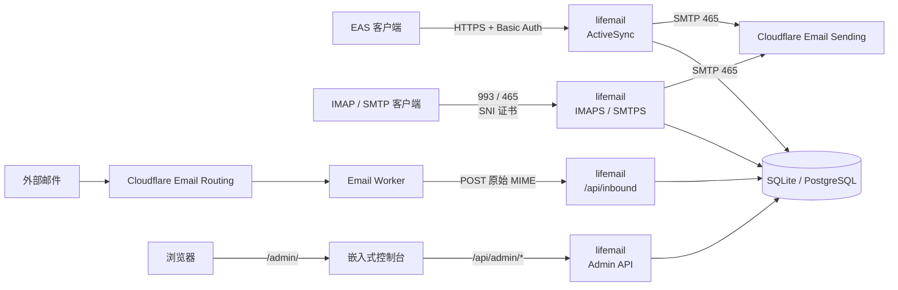

# lifemail

面向小团队的自托管邮件服务器：**一份二进制**同时提供 Exchange ActiveSync、IMAPS、SMTPS、
收信 API 和一套新的管理控制台。默认 SQLite，也可以直接跑在 PostgreSQL 上。

- **EAS 同步**：`/Microsoft-Server-ActiveSync`（iOS 邮件、Outlook、Windows 邮件等）
- **标准邮件协议**：IMAPS 993、SMTPS 465（按域名证书，SNI 选择）
- **发信**：Cloudflare Email Sending（`smtp.mx.cloudflare.net:465`，隐式 TLS）
- **收信**：Cloudflare Email Routing → Worker → `POST /api/inbound`
- **管理控制台**：`/admin/`，Token 登录，管理账号、地址、域名证书、发件队列、设备、日历订阅
- **只读日历订阅**：`/calendar/<uuid>.ics`，任何日历 App 都能订阅

---

## 架构



详细分层、表结构与同步模型见 [docs/architecture.md](docs/architecture.md)；
EAS 真机行为与踩坑记录见 [docs/eas-notes.md](docs/eas-notes.md)。

---

## 快速开始

```bash
# 1. 构建（前端构建后嵌入二进制；需要 Node 22+）
make build

# 2. 初始化数据库（serve 也会自动迁移，这一步可以省略）
./lifemail db migrate

# 3. 创建账号（不指定 -password 会随机生成并打印一次）
./lifemail user add -name alice -address alice@example.com -display "Alice"

# 4. 配置
cp .env.example .env
#    至少设置 LIFEMAIL_INBOUND_TOKEN / LIFEMAIL_ADMIN_TOKEN
#    域名、证书、SMTP 在控制台 /admin/ 里配置

# 5. 启动
set -a; . ./.env; set +a
./lifemail serve
```

默认监听 `:8080`，数据库为 `$LIFEMAIL_DB_DSN`（默认 `lifemail.db`）。

**必须放在 HTTPS 后面**：EAS 使用 HTTP Basic Auth，凭据只能通过 TLS 传输。

```caddyfile
mail.example.com {
    reverse_proxy 127.0.0.1:8080
}
```

没有公网 IP 时可以用 Cloudflare Tunnel 暴露服务。

---

## 配置

| 环境变量 | 默认值 | 说明 |
|---|---|---|
| `LIFEMAIL_ADDR` | `:8080` | HTTP 监听地址 |
| `LIFEMAIL_DB_DSN` | `lifemail.db` | SQLite 文件路径；`postgres://` 开头时连接 PostgreSQL |
| `LIFEMAIL_AUTO_MIGRATE` | `1` | 启动时应用迁移；设为 0 时由 `db migrate` 单独执行 |
| `LIFEMAIL_INBOUND_TOKEN` | 空 | 收信 API 的 Bearer token；为空时拒绝所有收信请求 |
| `LIFEMAIL_ADMIN_TOKEN` | 空 | `/api/admin/*` 与控制台的 token；为空时管理接口关闭 |
| `LIFEMAIL_ATTACHMENT_DIR` | `attachments` | MIME 原文与附件正文目录，可指向 rclone 挂载点 |
| `LIFEMAIL_PUBLIC_BASE_URL` | 空 | 打印日历订阅绝对地址用，例如 `https://mail.example.com` |
| `LIFEMAIL_EAS_DUMP` | 空 | 设置后把 WBXML 请求体落盘，便于离线排查 |
| `LIFEMAIL_LOG_LEVEL` | `info` | `debug` / `info` / `warn` / `error` |

邮件域、TLS 证书与 SMTP 参数存在数据库里，不进环境变量，见下文。

---

## 数据库与迁移

schema 由版本化迁移定义（`internal/store/migrations/NNNN_name.<dialect>.sql`），
随二进制嵌入，启动时自动应用；也可以显式执行：

```bash
./lifemail db status     # 已应用 / 待应用
./lifemail db migrate    # 应用
```

- 迁移**只前向**：已应用的版本不会重跑，**不支持降级**（回滚 = 恢复备份）
- 每个文件记录 checksum；已发布的迁移文件**只读**，修改会导致启动失败，正确做法是新增一个版本
- 破坏性变更分三步：新增列/双写 → 回填 → 下一版删除旧列
- 本项目**不迁移**重写前的旧数据库（PocketBase / v0.3.x）；从 v1 起，schema 仍然必须通过迁移演进
- 仓库根目录的 [AGENTS.md](AGENTS.md) 记录了这些规则，供自动化助手遵守

切换 PostgreSQL 只需换 DSN：

```bash
LIFEMAIL_DB_DSN='postgres://lifemail:secret@db:5432/lifemail?sslmode=disable' ./lifemail serve
```

两种方言的迁移文件保持字段一一对应。

---

## 管理控制台

打开 `https://mail.example.com/admin/`，输入 `LIFEMAIL_ADMIN_TOKEN`。

| 页面 | 能做什么 |
|---|---|
| 概览 | 账号 / 邮件 / 设备 / 队列计数，发信与域名状态，迁移版本 |
| 用户 | 新建账号、改显示名、重置密码（只显示一次）、删除、管理别名与主地址 |
| 地址与别名 | 把额外地址投递到已有账号 |
| 域名与证书 | 收信域列表 + IMAPS/SMTPS 证书路径，保存时校验文件与密钥匹配 |
| 发件队列 | 5 秒自动刷新、按状态过滤、单条重试/放弃 |
| 设备 | 已配对的 ActiveSync 客户端，远程擦除 / 移除，清理变更记录 |
| 日历订阅 | 每个日历的公开开关与订阅链接 |
| 设置 | SMTP 主机、端口、Token、兜底 From |
| 诊断 | 版本、数据库方言、迁移记录、服务端点、排查提示 |

界面支持浅色/深色主题、移动端抽屉导航；所有写操作都有确认弹窗与结果提示。

---

## 客户端配置

| 项目 | 值 |
|---|---|
| 服务器 | `https://mail.example.com/Microsoft-Server-ActiveSync` |
| 用户名 | 账号名（`alice`）或该账号的任一地址（`alice@example.com`） |
| 密码 | `lifemail user add` 输出的密码 |
| 自动发现 | `https://mail.example.com/autodiscover/autodiscover.xml` |

账号不绑定域名：一个账号可以拥有多个地址（主地址 + 别名），
其中 `is_primary` 的那条是默认发件地址。

---

## 发信（Cloudflare Email Sending）

1. 在 Cloudflare 控制台为发件域名开启 **Email Sending**
2. 创建 API Token，权限选 **Email Sending: Edit**
3. 控制台「设置」里填入 Token（`smtp.username` 保持 `api_token`）
4. 在「域名与证书」里加上发件域名

Cloudflare 的硬限制：只支持 `465` 隐式 TLS；`MAIL FROM` 必须属于已 onboard 的域名；
单封邮件最大 **5 MiB**，单次会话最多 **50 个收件人**。

外部地址投递失败时写入 `outbox`，后台按 1/2/4/8/16/32 分钟退避，最多 20 次（约 12 小时），
之后标记失败并保留记录；控制台可以直接重试或放弃。

---

## 收信（Cloudflare Email Routing）

```bash
cd deploy
npx wrangler secret put LIFEMAIL_INBOUND_TOKEN   # 与 LIFEMAIL_INBOUND_TOKEN 一致
npx wrangler deploy
```

1. 修改 `deploy/wrangler.toml` 中的 `LIFEMAIL_INBOUND_URL`
2. 在 Cloudflare 控制台把目标域名路由到该 Worker（catch-all 即可）
3. Worker 会附带信封收件人（`X-Envelope-To`），把原始 MIME POST 到 API

API 行为：

- `POST /api/inbound`，`Authorization: Bearer <token>` 或 `X-Lifemail-Token`
- 支持原始 MIME，也支持 JSON `{"to":["a@x"],"raw":"<base64>"}`
- 收件人解析：主地址/别名 → plus 地址（`alice+tag@example.com`）
- 同一 `Message-ID` 重复投递自动去重；未知收件人返回 `skipped`

---

## 存储

```
data/lifemail.db
attachments/raw/01/1-<hash>.eml    ← 整封 MIME
attachments/att/01/1-<hash>.pdf    ← 附件正文
attachments/out/01/1-<hash>.eml    ← 排队中的邮件
```

数据库只保存可搜索字段和相对路径；**目录丢失等同于邮件内容丢失**，
备份时必须把数据库与 `LIFEMAIL_ATTACHMENT_DIR` 一起备份。

---

## 容器部署

镜像只包含预编译的静态二进制，不包含 Go 工具链：

```bash
make build        # 先构建前端，再交叉编译
make image        # docker build -t lifemail:latest .

docker run -d --name lifemail -p 8080:8080 \
  --env-file .env \
  -v "$PWD/data:/data" \
  lifemail:latest
```

ARM 服务器：`make build GOARCH=arm64 image`。

镜像自带 `HEALTHCHECK`，每 30 秒请求 `/healthz`。

---

## 开发

```bash
go test ./...          # EAS / IMAP / SMTP / 收信 / 管理接口 / 迁移
go vet ./...
make check             # gofmt + vet + 前端 svelte-check

cd web
npm install
npm run dev            # 另开终端运行 ./lifemail serve
npm run build          # 输出到 web/build，供 go:embed 使用
```

版本号由 `make build` 注入：`git describe --tags --always --dirty`。

---

## 已知限制

- 不支持 Tasks、Notes、S/MIME、收件箱规则、会话视图、远程擦除的实际下发
- 服务器不展开重复事件（展开由客户端完成）；忙闲只统计已存实例
- `Search` 只匹配主题/发件人/正文，不支持自定义属性与附件内容搜索
- EAS 不提供日历分享 UI，对外分享只能通过只读 `.ics` 订阅
- 收件只走 Cloudflare Worker API，不提供 SMTP 入站
- 联系人头像不下发（base64 内嵌会让全量同步流量翻数倍）

## 安全

- EAS / IMAP / SMTP / 后台登录共用一套失败限流：10 分钟 5 次失败锁定 5 分钟
- 客户端 IP 取自 `X-Forwarded-For`；服务默认部署在 CDN / 反向代理之后
- 后台会话为 `HttpOnly + SameSite=Strict` Cookie，写操作校验 `Origin`
- 访问日志包含 method/path/status/duration/ip/request_id/ua；`X-Request-Id` 会回写到响应头
